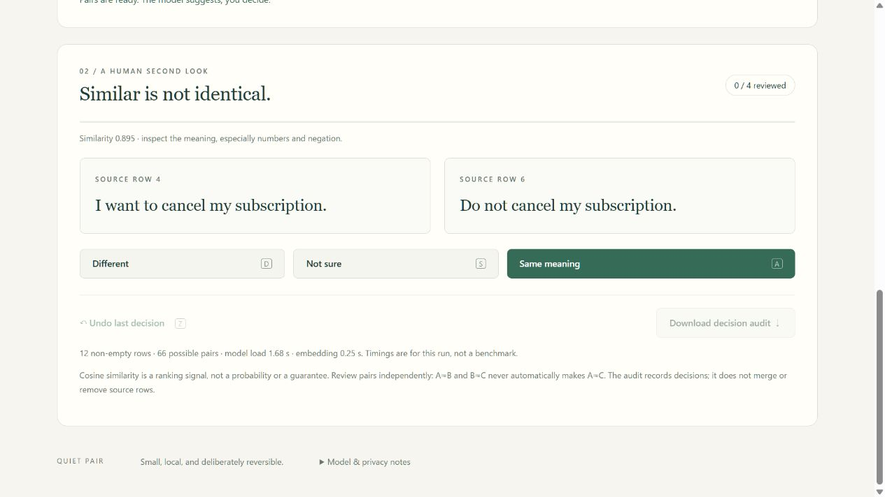

# Quiet Pair

Find similar English sentences in a small CSV, then review what they actually mean. Quiet Pair uses an open sentence model in the browser to rank pairs. You record **Same meaning / Different / Not sure**; the application never removes or merges source rows.

[Open the demo](https://kgway.github.io/quiet-pair/) · [Source](https://github.com/kgway/quiet-pair)

## Try it

1. Click **Try a synthetic example**, then **Find similar pairs**.
2. Read both sentences, especially negation, names and numbers. Use the buttons or **A / D / S** for same / different / not sure. **Z** undoes the last decision when focus is outside an input.
3. Download the decision audit before closing the tab. Data and decisions are held in that tab; they are not saved as a workspace.

Or paste a UTF-8 CSV with a header row, choose a text column, and run the same review. The similarity floor filters the review queue; it does not classify pairs below the floor as different.



## Run locally

No package install or API key is needed. Serve this directory, then open `http://127.0.0.1:8766/`:

```sh
python -m http.server 8766 --bind 127.0.0.1 --directory .
```

The first run needs network access to download Transformers.js, the model and runtime files. Inference runs in a Web Worker using q8 weights and WebAssembly. The application has no CSV upload endpoint; suppliers of downloaded software still receive normal connection metadata. Use synthetic or non-sensitive data while evaluating the app. Offline reloading has not been verified.

## Deliberate limits

- English sentence matching; Unicode CSV parsing does not make the model multilingual.
- At most 150 data rows, 500 characters per selected cell and a 2 MB file. Blank selected cells are excluded from inference. Long inputs may still be truncated by the model.
- Cosine similarity is a ranking signal, not a probability or proof of equivalent meaning. Read the original text.
- Pair decisions remain independent: A≈B and B≈C never automatically merges A with C.
- The export is a decision audit, not a cleaned source CSV. Undo changes the audit, and no source row is overwritten.

The audit records both texts, source row numbers, cosine score, verdict, time, model revision, selected column and a SHA-256 fingerprint. The fingerprint covers UTF-8 text after browser decoding, not necessarily the original file bytes. Formula-like text is prefixed in the exported CSV to reduce spreadsheet formula execution risks.

## Validation

```sh
node --test core.test.mjs
```

Six tests passed locally, covering CSV quoting/newlines/Unicode, malformed inputs, cosine ranking, independent pair decisions, undo, audit export and source preservation. Static source assertions check text-only DOM insertion; they are not an end-to-end security test.

An automated UI check on Windows in the Codex in-app browser exercised actual model inference, all three decisions, undo and a four-row audit download. With 12 synthetic rows, the app computed 66 pairs and displayed four at a 0.72 floor. It reported 1.68 s initialization and 0.25 s embedding time in that one run; cache state and hardware were not measured. The highest pair was a cancellation request versus its negation (0.895). This is a useful counterexample, not an accuracy benchmark or human user study. Offline operation, accessibility conformance and broad browser compatibility are not claimed.

## Open components and license

Original application code and synthetic fixtures are available under the [MIT License](./LICENSE). External software and model weights retain their own licenses; they are downloaded rather than bundled here. See [DEPENDENCIES.md](./DEPENDENCIES.md) for pinned versions, model revision, provenance and the scope of the dependency review.

Created during the Hacktoberfest Open-Source AI Challenge Week 3 window in October 2026.
